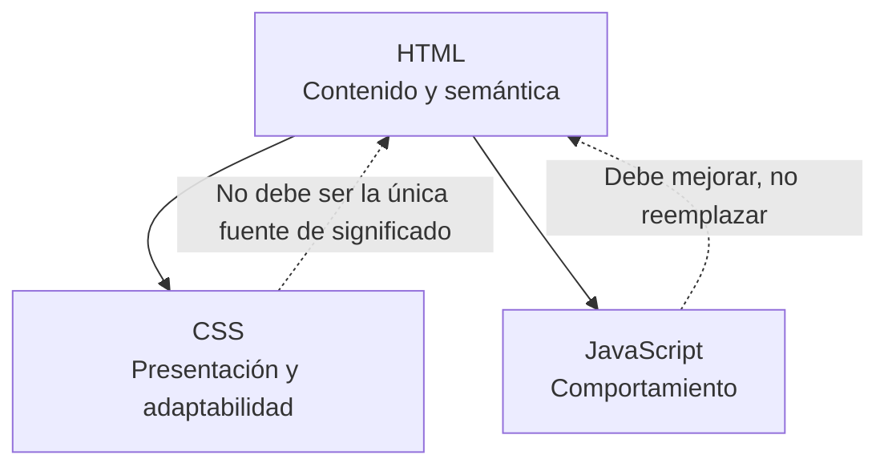

# Unidad II — Construcción de una interfaz web

> [!NOTE] Fundamento central
> Una interfaz web separa **estructura**, **presentación** y **comportamiento**. HTML describe el significado y la organización del contenido; CSS define cómo se presenta; JavaScript, que aparece en la próxima clase, aporta comportamiento. Esta separación no es una regla estética: permite que la interfaz sea comprensible, accesible, adaptable y mantenible.

> [!TIP] Pregunta conductora
> ¿Cómo se construye una página que siga teniendo sentido si cambia el tamaño de la pantalla, si se navega con teclado o si el CSS no carga?

## 1. Tres responsabilidades

| Tecnología | Responsabilidad | Pregunta que responde |
|---|---|---|
| **HTML** | Estructura y significado | ¿Qué es cada cosa y cómo se relaciona con las demás? |
| **CSS** | Presentación | ¿Cómo se ve y cómo se adapta al espacio disponible? |
| **JavaScript** | Comportamiento | ¿Qué ocurre cuando la persona interactúa? |

La separación es un **principio de diseño**, no una frontera absoluta. CSS puede animar y HTML tiene comportamientos nativos, como `<details>` o la validación de formularios. Lo importante es que cada tecnología tenga una responsabilidad principal clara y que el contenido no dependa de una capa que puede fallar.



> [!IMPORTANT] Por qué importa
> Si la estructura depende de CSS y el CSS falla, el contenido se vuelve incomprensible. Si un botón es un `<div>` con un `onclick`, no se puede activar con teclado ni lo reconocen los lectores de pantalla. La separación correcta produce interfaces más robustas, no solo más ordenadas.

## 2. El documento HTML

Un documento HTML es un árbol de elementos. Cada elemento puede tener atributos y contenido.

```html
<!DOCTYPE html>
<html lang="es">
<head>
	<meta charset="utf-8">
	<meta name="viewport" content="width=device-width, initial-scale=1">
	<title>Actividades</title>
</head>
<body>
	<h1>Actividades</h1>
	<p>Organiza lo que tienes pendiente.</p>
</body>
</html>
```

| Parte | Función |
|---|---|
| `<!DOCTYPE html>` | Indica al navegador que use el modo estándar de HTML. |
| `<html lang="es">` | Declara el idioma del documento. Ayuda a lectores de pantalla, traductores y buscadores. |
| `<head>` | Metadatos: codificación, viewport, título, hojas de estilo. No se muestra como contenido. |
| `<body>` | Contenido visible del documento. |
| `<meta name="viewport">` | Indica que el ancho de la página debe adaptarse al dispositivo. Sin esta etiqueta, el diseño responsive no funciona como se espera en móviles. |

### Elementos y atributos

```html
<a href="/curso" title="Ir al curso">Curso</a>
```

- `a` es el elemento.
- `href` y `title` son atributos.
- `Curso` es el contenido.
- Algunos elementos, como `` o `<input>`, no tienen contenido ni etiqueta de cierre. Se los llama **elementos vacíos**.

### HTML semántico

La semántica consiste en elegir el elemento que mejor describe el contenido, no el que se ve mejor por defecto.

| En lugar de… | Usar… | Porque… |
|---|---|---|
| `<div class="header">` | `<header>` | El navegador y las tecnologías de asistencia reconocen la cabecera. |
| `<div class="nav">` | `<nav>` | Identifica una región de navegación. |
| `<div class="main">` | `<main>` | Marca el contenido principal y único de la página. |
| `<div class="post">` | `<article>` | Indica una unidad de contenido autocontenida. |
| `<div class="footer">` | `<footer>` | Identifica el pie de página o de sección. |
| `<span onclick="...">` | `<button>` | Aporta comportamiento, foco y accesibilidad por defecto. |

La jerarquía de encabezados también es semántica:

```html
<h1>Actividades</h1>
	<h2>Nueva actividad</h2>
	<h2>Pendientes</h2>
		<h3>Esta semana</h3>
```

No se elige `h3` porque “se ve más pequeño”. Se elige por nivel estructural. El tamaño se controla con CSS.

### Enlaces y botones

- **Enlace (`<a>`)**: navega a otro recurso o a otra parte del documento.
- **Botón (`<button>`)**: ejecuta una acción dentro de la página.

Un enlace que no lleva a ninguna parte y solo ejecuta una acción es, conceptualmente, un botón. Un botón que navega a otra página es, conceptualmente, un enlace. La elección correcta mejora el teclado, el menú contextual y la semántica.

## 3. Formularios

Un formulario permite **recoger datos**. Su estructura mínima incluye un formulario, controles, etiquetas y un botón de envío.

```html
<form id="form-actividad">
	<div class="campo">
		<label for="titulo">Título</label>
		<input id="titulo" name="titulo" type="text" required maxlength="120">
	</div>

	<div class="campo">
		<label for="fecha">Fecha límite</label>
		<input id="fecha" name="fecha" type="date">
	</div>

	<button type="submit">Agregar</button>
</form>
```

### Piezas clave

| Pieza | Función |
|---|---|
| `<form>` | Agrupa los controles y define cómo se envían. |
| `<label for="...">` | Asocia una etiqueta visible con un control. El `for` debe coincidir con el `id`. |
| `name` | Es la clave con la que el dato viaja al servidor. Sin `name`, el control no se envía. |
| `type` | Define el comportamiento y la validación nativa: `text`, `email`, `date`, `number`, `checkbox`. |
| `required` | Indica que el campo es obligatorio para el navegador. |
| `<button type="submit">` | Envía el formulario. |
| `<fieldset>` y `<legend>` | Agrupan controles relacionados, por ejemplo un conjunto de opciones. |

> [!WARNING] La validación del navegador no es seguridad
> `required`, `maxlength` o `type="email"` mejoran la experiencia, pero se pueden eludir: basta con enviar una petición directamente. **Toda validación debe repetirse en el servidor.** El navegador valida para ayudar a la persona; el servidor valida para proteger el sistema.

### El atributo `name`

```html
<input name="titulo" value="Leer capítulo 1">
<input name="fecha" value="2026-10-20">
```

Al enviar el formulario, los datos se convierten en pares `clave=valor`:

```text
titulo=Leer+cap%C3%ADtulo+1&fecha=2026-10-20
```

Ese formato se llama `application/x-www-form-urlencoded`. Si el formulario usa `method="post"`, los datos viajan en el cuerpo; si usa `GET`, en la query de la URL. En esta clase el formulario todavía no tiene backend: al enviarlo, el navegador recarga la página. Eso es esperado.

## 4. Accesibilidad desde el inicio

La accesibilidad no es una capa que se agrega al final. Es una consecuencia de construir con semántica y con el teclado en mente.

Buenas prácticas mínimas:

- **Usar HTML semántico.** Un `<button>` ya es accesible; un `<div>` con un clic no.
- **Etiquetar todos los controles.** El `label` debe estar asociado, no solo visualmente cerca.
- **Mantener el foco visible.** No eliminar `outline` sin reemplazarlo por un indicador claro.
- **Permitir navegación con teclado.** `Tab` para avanzar, `Shift+Tab` para retroceder, `Enter` o `Espacio` para activar.
- **No depender solo del color.** Un error no puede distinguirse únicamente por rojo; necesita texto o un ícono.
- **Escribir texto alternativo útil.** `alt=""` es correcto para imágenes decorativas; para una imagen con contenido, describir su función.
- **Respetar el zoom y el reflujo.** El contenido debe seguir siendo usable al ampliar o al reducir el ancho.

> [!TIP] Prueba rápida
> Navegar la página usando solo el teclado. Si no se puede llegar al formulario, si el foco no se ve o si el orden de tabulación no tiene sentido, hay un problema de accesibilidad.

## 5. CSS: reglas, cascada y caja

Una hoja de estilo es un conjunto de reglas. Cada regla tiene un **selector** y un bloque de **declaraciones**.

```css
/* selector: h1 */
h1 {
	/* propiedad: valor */
	color: #23292b;
	font-size: 2rem;
}
```

### Cascada y especificidad

Cuando varias reglas afectan al mismo elemento, el navegador decide cuál gana. Los criterios, en orden aproximado, son:

1. **Origen e importancia:** estilos del navegador, del autor, del usuario y `!important`.
2. **Especificidad:** un `id` pesa más que una clase, y una clase más que un elemento.
3. **Orden de aparición:** a igual especificidad, gana la regla que aparece después.

```css
p { color: gray; }
.destacado { color: blue; }
#unico { color: red; }
```

Un párrafo con `class="destacado"` e `id="unico"` será rojo, porque el `id` tiene mayor especificidad.

> [!WARNING] `!important` no arregla la cascada
> Si se necesita `!important` para que una regla funcione, probablemente el problema sea de estructura de selectores. Conviene resolver la causa, no taparla.

### Herencia

Algunas propiedades se heredan de un elemento a sus descendientes, como `color` y `font-family`. Otras no, como `margin`, `padding` o `border`. Entender la herencia evita repetir declaraciones innecesarias.

### El modelo de caja

Todo elemento se representa como una caja con cuatro áreas:

```text
┌─────────────────────────────┐
│           margin            │
│  ┌───────────────────────┐  │
│  │        border         │  │
│  │  ┌─────────────────┐  │  │
│  │  │    padding      │  │  │
│  │  │  ┌───────────┐  │  │  │
│  │  │  │ contenido │  │  │  │
│  │  │  └───────────┘  │  │  │
│  │  └─────────────────┘  │  │
│  └───────────────────────┘  │
└─────────────────────────────┘
```

Por defecto, `width` y `height` se aplican al contenido, y el padding y el borde se suman al tamaño final. Para que el tamaño declarado incluya todo, se usa:

```css
*, *::before, *::after {
	box-sizing: border-box;
}
```

Esta es una de las pocas reglas globales que se justifican: hace que el modelo de caja sea predecible.

### Flujo normal, Flexbox y Grid

- **Flujo normal:** los elementos de bloque se apilan; los elementos en línea fluyen con el texto.
- **Flexbox:** distribuye elementos en **una dimensión**, fila o columna.
- **Grid:** organiza elementos en **dos dimensiones**, filas y columnas.

No son alternativas excluyentes. Se elige la herramienta según la relación espacial que se quiere expresar.

## 6. Diseño adaptable

Diseñar de forma adaptable no es “hacer una versión para móvil”. Es construir una interfaz que responda al espacio disponible.

Principios prácticos:

- **Partir del contenido y del flujo normal.** No posicionar todo de forma absoluta.
- **Usar unidades relativas** cuando corresponda: `rem`, `%`, `ch`, `vw`, `clamp()`.
- **Evitar alturas fijas** en bloques con texto variable.
- **Permitir que los elementos se envuelvan** con `flex-wrap`.
- **Usar `max-width`** en lugar de anchos fijos para los contenedores.
- **Probar en anchos extremos**, no solo en el tamaño de la laptop.

```css
.contenedor {
	width: min(100% - 2rem, 720px);
	margin-inline: auto;
}
```

`min()` elige el menor de los dos valores: el contenedor ocupa el ancho disponible menos un margen, pero nunca supera los `720px`.

### Media queries

Una media query aplica reglas cuando se cumple una condición sobre el dispositivo o la ventana.

```css
@media (max-width: 520px) {
	.lista li {
		flex-direction: column;
	}
}
```

El enfoque **mobile-first** consiste en escribir primero el diseño para pantallas pequeñas y luego ampliar con `min-width`. El enfoque inverso también es válido, pero hay que ser consistente.

> [!NOTE] El viewport no es opcional
> Sin `<meta name="viewport" content="width=device-width, initial-scale=1">`, los móviles simulan una pantalla de escritorio y reducen la página. El diseño adaptable parece “no funcionar” aunque el CSS sea correcto.

## 7. Práctica: la página de actividades

El objetivo es construir la base del proyecto: una página con un formulario y una lista. Todavía no tendrá comportamiento; el envío del formulario recargará la página. En la próxima clase JavaScript tomará el control.

### `index.html`

```html
<!DOCTYPE html>
<html lang="es">
<head>
	<meta charset="utf-8">
	<meta name="viewport" content="width=device-width, initial-scale=1">
	<title>Actividades</title>
	<link rel="stylesheet" href="styles.css">
</head>
<body>
	<header class="encabezado">
		<h1>Actividades</h1>
		<p class="subtitulo">Organiza lo que tienes pendiente.</p>
	</header>

	<main>
		<section aria-labelledby="titulo-formulario">
			<h2 id="titulo-formulario">Nueva actividad</h2>

			<form id="form-actividad" class="formulario">
				<div class="campo">
					<label for="titulo">Título</label>
					<input id="titulo" name="titulo" type="text" required maxlength="120" autocomplete="off">
				</div>

				<div class="campo">
					<label for="fecha">Fecha límite</label>
					<input id="fecha" name="fecha" type="date">
				</div>

				<button type="submit">Agregar</button>
			</form>
		</section>

		<section aria-labelledby="titulo-lista">
			<h2 id="titulo-lista">Pendientes</h2>

			<ul id="lista-actividades" class="lista">
				<li>
					<span>Leer el capítulo 1</span>
					<time datetime="2026-10-20">20/10/2026</time>
				</li>
			</ul>
		</section>
	</main>

	<footer class="pie">
		<p>Proyecto del curso de Desarrollo Web.</p>
	</footer>
</body>
</html>
```

### `styles.css`

```css
:root {
	--fondo: #f5f6f4;
	--superficie: #ffffff;
	--texto: #23292b;
	--texto-suave: #5c6662;
	--acento: #2f6fb0;
	--borde: #d6dcd8;
	--radio: 10px;
}

*,
*::before,
*::after {
	box-sizing: border-box;
}

body {
	margin: 0;
	font-family: system-ui, -apple-system, "Segoe UI", sans-serif;
	line-height: 1.5;
	color: var(--texto);
	background: var(--fondo);
}

.encabezado,
main,
.pie {
	width: min(100% - 2rem, 720px);
	margin-inline: auto;
}

.encabezado {
	padding-block: 2.5rem 1.5rem;
}

.encabezado h1 {
	margin: 0 0 0.25rem;
	font-size: clamp(1.8rem, 5vw, 2.6rem);
}

.subtitulo {
	margin: 0;
	color: var(--texto-suave);
}

main {
	display: grid;
	gap: 2rem;
	padding-bottom: 3rem;
}

section {
	background: var(--superficie);
	border: 1px solid var(--borde);
	border-radius: var(--radio);
	padding: 1.25rem;
}

h2 {
	margin-top: 0;
	font-size: 1.15rem;
}

.formulario {
	display: flex;
	flex-wrap: wrap;
	gap: 1rem;
	align-items: end;
}

.campo {
	display: grid;
	gap: 0.35rem;
	flex: 1 1 220px;
}

label {
	font-weight: 600;
	font-size: 0.9rem;
}

input {
	width: 100%;
	padding: 0.6rem 0.7rem;
	font: inherit;
	color: inherit;
	background: var(--fondo);
	border: 1px solid var(--borde);
	border-radius: 8px;
}

input:focus-visible,
button:focus-visible {
	outline: 3px solid #9cc3e8;
	outline-offset: 2px;
}

button {
	padding: 0.65rem 1.1rem;
	font: inherit;
	font-weight: 600;
	color: #ffffff;
	background: var(--acento);
	border: 0;
	border-radius: 8px;
	cursor: pointer;
}

button:hover {
	background: #255a91;
}

.lista {
	list-style: none;
	margin: 0;
	padding: 0;
	display: grid;
	gap: 0.5rem;
}

.lista li {
	display: flex;
	justify-content: space-between;
	gap: 1rem;
	padding: 0.75rem;
	border: 1px solid var(--borde);
	border-radius: 8px;
}

.lista time {
	color: var(--texto-suave);
	white-space: nowrap;
}

.pie {
	padding-block: 1.5rem;
	border-top: 1px solid var(--borde);
	color: var(--texto-suave);
	font-size: 0.9rem;
}

@media (max-width: 520px) {
	.lista li {
		flex-direction: column;
		gap: 0.25rem;
	}
}
```

### Qué observar en el código

- `:root` define **variables CSS** reutilizables. Cambiar `--acento` cambia todos los usos.
- `width: min(100% - 2rem, 720px)` crea un contenedor flexible con un máximo legible.
- `main` usa `display: grid` con `gap` para separar secciones sin márgenes manuales.
- `.formulario` usa Flexbox con `flex-wrap` para que los campos se acomoden en una o varias filas.
- `flex: 1 1 220px` permite que cada campo crezca, se encoja y tenga una base de `220px`.
- `:focus-visible` garantiza un indicador de foco visible para quien navega con teclado.
- La media query cambia la dirección de la lista en pantallas angostas.

## 8. Errores frecuentes

- Usar `<div>` para todo y agregar clics con JavaScript.
- Poner el texto del campo en un `placeholder` y omitir el `<label>`.
- Omitir `name` en los controles y preguntarse por qué no llegan los datos.
- Fijar alturas en píxeles y provocar que el texto se desborde.
- Usar `position: absolute` para maquetar en lugar de Flexbox o Grid.
- Eliminar el `outline` del foco sin reemplazarlo.
- Usar `!important` para resolver un conflicto de especificidad.
- Confundir un enlace con un botón.
- Olvidar el `viewport` y concluir que el CSS responsive “no funciona”.

## 9. Actividad

1. Completar la página con un campo adicional, por ejemplo una prioridad (`<select>`) o una descripción (`<textarea>`).
2. Verificar que todos los controles tengan `label` asociado y `name`.
3. Navegar toda la página solo con el teclado. Comprobar que el foco sea visible y el orden tenga sentido.
4. Reducir la ventana hasta un ancho cercano a `320px`. Corregir lo que se rompa.
5. Aumentar el zoom al `200%`. Verificar que el contenido siga siendo usable.
6. Ejecutar el validador de HTML del W3C y corregir los errores que aparezcan.
7. Servir la página con `python3 -m http.server 8000` y revisar en Network que el CSS se cargue con estado `200`.

> [!TIP] Preguntas para la puesta en común
> - ¿Qué parte de la página sigue siendo comprensible si se desactiva el CSS?
> - ¿Qué elemento se eligió para cada región y por qué?
> - ¿Qué diferencia hay entre un `placeholder` y un `label`?
> - ¿Qué ocurre al enviar el formulario? ¿Por qué se recarga la página?

## 10. Avance del proyecto

1. Guardar `index.html` y `styles.css` en la carpeta del proyecto.
2. Inicializar el repositorio y registrar el primer avance:

```bash
git init
git add index.html styles.css
git commit -m "Agregar estructura y estilos de la página de actividades"
```

3. Verificar la página servida localmente y dejar anotadas las decisiones de estructura: qué regiones se definieron, qué elementos semánticos se usaron y por qué.

> [!NOTE] Lo que todavía no ocurre
> El formulario no agrega actividades. Al enviarlo, el navegador recarga la página porque no hay código que intercepte el evento. Esa es la tarea de la próxima clase: pasar de una página estática a una interfaz con estado y comportamiento.

## 11. Comprobación de comprensión

1. ¿Qué responsabilidad tiene cada una de las tres tecnologías de la interfaz?
2. ¿Por qué no conviene usar un `<div>` como botón?
3. ¿Para qué sirve el atributo `name` en un control de formulario?
4. ¿Por qué la validación del navegador no alcanza?
5. ¿Qué hace `box-sizing: border-box` y por qué se aplica globalmente?
6. ¿Cuándo conviene Flexbox y cuándo Grid?
7. ¿Qué problema resuelve el `viewport` en dispositivos móviles?
8. ¿Qué significa que una interfaz sea accesible más allá de “que se vea bien”?

> [!NOTE] Criterio de evaluación
> Se espera poder **justificar la estructura**: por qué se eligió cada elemento, qué ocurre si se desactiva el CSS, cómo se navega con teclado y qué parte del diseño se adapta y cuál no. Copiar una plantilla sin poder explicarla no cumple el objetivo.

## Referencias

### Lectura base

- MDN. [Structuring content with HTML](https://developer.mozilla.org/en-US/docs/Learn_web_development/Core/Structuring_content).
- MDN. [CSS styling basics](https://developer.mozilla.org/en-US/docs/Learn_web_development/Core/Styling_basics).
- MDN. [Accessibility](https://developer.mozilla.org/en-US/docs/Web/Accessibility).

### Consulta

- MDN. [HTML elements reference](https://developer.mozilla.org/en-US/docs/Web/HTML/Element).
- MDN. [CSS reference](https://developer.mozilla.org/en-US/docs/Web/CSS).
- MDN. [Forms](https://developer.mozilla.org/en-US/docs/Learn_web_development/Extensions/Forms).
- W3C. [WAI Tutorials](https://www.w3.org/WAI/tutorials/).

### Profundización

- web.dev. [Learn HTML](https://web.dev/learn/html) y [Learn CSS](https://web.dev/learn/css).
- Pickering, H. [Inclusive Components](https://inclusive-components.design/).
- W3C. [Web Content Accessibility Guidelines (WCAG) 2.2](https://www.w3.org/TR/WCAG22/).
- Yablonski, J. [Laws of UX](https://lawsofux.com/).
