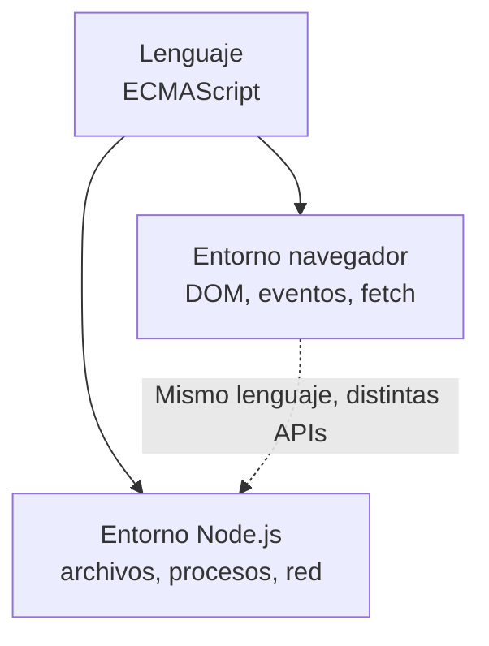
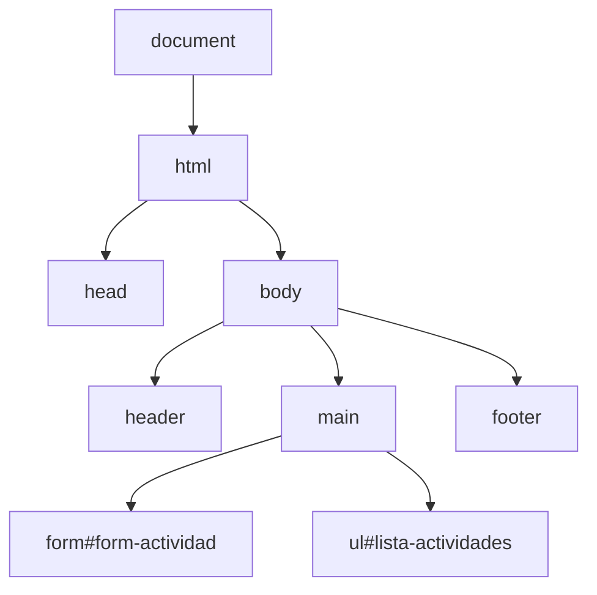
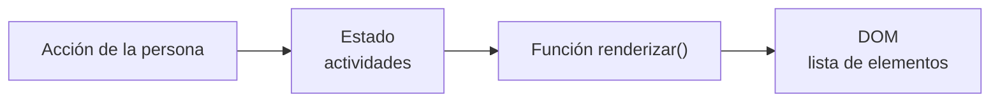

# Unidad III — JavaScript y el navegador

> [!NOTE] Fundamento central
> JavaScript es un lenguaje que se ejecuta en un **entorno**. En el navegador, ese entorno ofrece APIs para leer y modificar el documento, escuchar eventos y comunicarse por red. La interfaz se vuelve programable cuando se distingue entre los **datos** de la aplicación y su **representación** en el DOM.

> [!TIP] Pregunta conductora
> ¿Cómo pasa una página de ser un documento fijo a una interfaz que responde a lo que hace la persona?

## 1. El lenguaje y su entorno

JavaScript no es “el lenguaje del navegador”. Es un lenguaje con una especificación propia, **ECMAScript**, que puede ejecutarse en distintos entornos:

| Entorno | Qué aporta |
|---|---|
| **Navegador** | `document`, `window`, eventos, `fetch`, `localStorage`, APIs de multimedia. |
| **Node.js** | Sistema de archivos, procesos, red de bajo nivel, servidores HTTP. |
| **Deno / Bun** | Otros runtimes con APIs propias. |

El lenguaje define cosas como variables, funciones, objetos y operadores. El entorno define **qué puede hacer el programa además de calcular**: acceder al DOM, leer un archivo o abrir un socket.



> [!IMPORTANT] Consecuencia práctica
> `document` no existe en Node.js y `fs` no existe en el navegador. Si un ejemplo “no funciona”, antes de revisar la sintaxis conviene preguntar si la API pertenece al entorno donde se está ejecutando.

## 2. Valores, variables y tipos

Los valores se agrupan en dos grandes familias:

- **Primitivos:** `string`, `number`, `boolean`, `null`, `undefined`, `symbol`, `bigint`.
- **Objetos:** arreglos, funciones, fechas, mapas y cualquier estructura creada por el programa.

```js
const titulo = "Leer el capítulo 1"; // string
let prioridad = 2;                    // number
const completada = false;             // boolean
const etiquetas = ["estudio", "casa"]; // array (objeto)
const actividad = { titulo, prioridad }; // objeto
```

### `const` y `let`

- `const` impide **reasignar** la variable, no congela el objeto.
- `let` permite reasignarla.
- `var` existe por compatibilidad histórica; en código nuevo se prefiere `let` o `const`.

```js
const actividad = { titulo: "Leer" };
actividad.titulo = "Leer el capítulo 1"; // válido: se modifica el objeto
// actividad = {}; // error: se intenta reasignar la variable
```

### Igualdad y coerción

JavaScript convierte tipos automáticamente en algunos contextos. Esa comodidad es también una fuente de errores.

```js
"5" == 5;   // true: compara con conversión de tipos
"5" === 5;  // false: compara valor y tipo
```

> [!WARNING] Usar `===` por defecto
> La comparación estricta evita conversiones implícitas. Reservar `==` para casos muy justificados, como comparar con `null` o `undefined` a la vez.

### Verdad y falsedad

Son falsos: `false`, `0`, `-0`, `0n`, `""`, `null`, `undefined`, `NaN`. Todo lo demás es verdadero, incluidos `"0"`, `[]` y `{}`. Esto explica por qué una validación debe ser explícita:

```js
if (titulo.trim() === "") {
	// campo vacío o solo espacios
}
```

## 3. Funciones

Una función agrupa un cálculo o una acción y le da un nombre. Permite **descomponer** un problema y reutilizar la solución.

```js
function formatearFecha(iso) {
	if (!iso) {
		return "Sin fecha";
	}

	const [anio, mes, dia] = iso.split("-");
	return `${dia}/${mes}/${anio}`;
}

console.log(formatearFecha("2026-10-20")); // 20/10/2026
```

También existe la forma de flecha:

```js
const formatearFecha = (iso) => {
	if (!iso) {
		return "Sin fecha";
	}

	const [anio, mes, dia] = iso.split("-");
	return `${dia}/${mes}/${anio}`;
};
```

La elección entre una y otra no es solo estética. Las funciones de flecha no tienen su propio `this`, lo que cambia su comportamiento en ciertos contextos. Para este curso, alcanza con usarlas de forma consistente y entender que ambas son funciones.

## 4. Objetos y arreglos

Un objeto agrupa datos con nombre. Un arreglo es una colección ordenada.

```js
const actividad = {
	id: "a1",
	titulo: "Leer el capítulo 1",
	fecha: "2026-10-20",
};

const actividades = [actividad];

console.log(actividades[0].titulo); // Leer el capítulo 1
```

Operaciones habituales sobre arreglos:

```js
actividades.push(nuevaActividad);          // agregar al final
const titulos = actividades.map((a) => a.titulo); // transformar
const pendientes = actividades.filter((a) => !a.completada); // filtrar
```

`map` y `filter` devuelven **nuevos arreglos**; no modifican el original. Esa distinción entre transformar y mutar es central para razonar sobre el estado.

## 5. El DOM: la representación manipulable

El navegador convierte el HTML en un árbol de nodos: el **DOM** (Document Object Model). JavaScript puede leerlo y modificarlo.



Seleccionar elementos:

```js
const form = document.querySelector("#form-actividad");
const lista = document.querySelector("#lista-actividades");
```

`querySelector` devuelve el primer elemento que coincide con un selector CSS, o `null` si no encuentra nada. Ese `null` es una de las causas más comunes de errores.

### Crear y modificar nodos

```js
const item = document.createElement("li");

const titulo = document.createElement("span");
titulo.textContent = "Leer el capítulo 1";

item.append(titulo);
lista.append(item);
```

| Operación | Para qué |
|---|---|
| `document.createElement(tag)` | Crear un elemento. |
| `element.textContent` | Leer o escribir texto plano. |
| `element.append(...)` | Agregar nodos o texto al final. |
| `element.replaceChildren(...)` | Reemplazar todo el contenido. |
| `element.classList.add/remove/toggle` | Modificar clases. |
| `element.setAttribute(...)` | Modificar atributos. |

> [!WARNING] `innerHTML` y datos de usuario
> `element.innerHTML = "<span>" + titulo + "</span>"` interpreta el string como HTML. Si `titulo` viene de un formulario, una persona puede inyectar etiquetas y scripts. Eso es **XSS** (cross-site scripting). Para contenido que no es HTML, usar `textContent` y crear nodos con `createElement`.

## 6. Eventos

Un evento es algo que ocurre: un clic, una tecla, el envío de un formulario, la carga de la página.

```js
form.addEventListener("submit", (evento) => {
	evento.preventDefault();
	console.log("Formulario enviado");
});
```

- `addEventListener` registra una función que se ejecuta cuando ocurre el evento.
- El objeto `evento` describe lo que pasó.
- `preventDefault()` cancela el comportamiento predeterminado del navegador. En un formulario, evita que la página se recargue.

> [!TIP] Escuchar `submit`, no el clic del botón
> El evento `submit` se dispara tanto al hacer clic como al presionar `Enter` en un campo. Escuchar el clic del botón deja afuera el envío por teclado y duplica lógica.

### Leer los datos del formulario

```js
const datos = new FormData(form);

const titulo = String(datos.get("titulo")).trim();
const fecha = String(datos.get("fecha") ?? "");
```

`FormData` usa el atributo `name` de cada control como clave. Es la misma información que el navegador enviaría al servidor, pero disponible en JavaScript antes de enviarla.

## 7. Estado y representación

Este es el cambio conceptual más importante de la clase.

- **Estado:** los datos que describen la aplicación. Por ejemplo, el arreglo `actividades`.
- **Representación:** lo que se muestra en pantalla. Por ejemplo, los `<li>` dentro de la lista.

La regla es:

> La representación se **deriva** del estado. No se guarda la verdad en el DOM.



Si se lee el estado desde el DOM, aparecen problemas: hay que interpretar texto, los datos se mezclan con la presentación y cualquier cambio exige sincronizar dos fuentes de verdad. En cambio, si el estado es la fuente única, la interfaz se reconstruye a partir de él.

## 8. Implementación completa

En `index.html`, agregar la referencia al script antes de cerrar `</body>`:

```html
<script src="app.js" defer></script>
```

`defer` indica que el script se descarga sin bloquear el parseo y se ejecuta cuando el DOM está listo. Sin `defer`, el script podría ejecutarse antes de que existan los elementos que busca.

### `app.js`

```js
const form = document.querySelector("#form-actividad");
const lista = document.querySelector("#lista-actividades");

const actividades = [
	{
		id: "a1",
		titulo: "Leer el capítulo 1",
		fecha: "2026-10-20",
	},
];

function formatearFecha(iso) {
	if (!iso) {
		return "Sin fecha";
	}

	const [anio, mes, dia] = iso.split("-");
	return `${dia}/${mes}/${anio}`;
}

function crearElementoActividad(actividad) {
	const item = document.createElement("li");

	const titulo = document.createElement("span");
	titulo.textContent = actividad.titulo;

	const fecha = document.createElement("time");
	if (actividad.fecha) {
		fecha.dateTime = actividad.fecha;
		fecha.textContent = formatearFecha(actividad.fecha);
	} else {
		fecha.textContent = "Sin fecha";
	}

	item.append(titulo, fecha);
	return item;
}

function renderizar() {
	lista.replaceChildren();

	for (const actividad of actividades) {
		lista.append(crearElementoActividad(actividad));
	}
}

form.addEventListener("submit", (evento) => {
	evento.preventDefault();

	const datos = new FormData(form);
	const titulo = String(datos.get("titulo") ?? "").trim();
	const fecha = String(datos.get("fecha") ?? "");

	if (titulo === "") {
		return;
	}

	actividades.push({
		id: crypto.randomUUID(),
		titulo,
		fecha,
	});

	form.reset();
	renderizar();
});

renderizar();
```

### Qué observar

- `actividades` es el estado. `renderizar()` lo traduce a DOM.
- `crearElementoActividad` se ocupa de **una** actividad; `renderizar` se ocupa de la **colección**. Separar responsabilidades hace que cada función sea más fácil de leer y probar.
- `textContent` evita interpretar el título como HTML.
- `form.reset()` limpia los campos después de agregar.
- `crypto.randomUUID()` genera un identificador único. Requiere un contexto seguro; `localhost` lo es.
- La lista escrita a mano en el HTML desaparece en la primera ejecución de `renderizar()`, porque `replaceChildren()` la reemplaza. Eso es intencional: ahora la fuente de verdad es el arreglo.

## 9. Depuración

Herramientas básicas:

- **Consola:** `console.log(actividades)`, `console.table(actividades)`.
- **Puntos de interrupción:** en la pestaña Sources, hacer clic en el número de línea. La ejecución se detiene y se pueden inspeccionar variables.
- **`debugger;`:** detiene la ejecución si las DevTools están abiertas.
- **Inspección del DOM:** verificar que los nodos existan y tengan las clases esperadas.

Errores frecuentes:

| Síntoma | Causa probable |
|---|---|
| `Cannot read properties of null` | El selector no coincide o el script se ejecuta antes de que exista el elemento. |
| El formulario recarga la página | Falta `evento.preventDefault()`. |
| Los datos llegan vacíos | Falta el atributo `name` en el control. |
| El título se muestra como HTML | Se usó `innerHTML` con datos de usuario. |
| Nada se actualiza | `renderizar()` no se llama después de modificar el estado. |
| El script no se ejecuta | Ruta incorrecta, error de sintaxis o el archivo no se cargó. |

> [!IMPORTANT] Leer el error, no adivinar
> La consola indica el archivo y la línea. Antes de cambiar código al azar, conviene leer el mensaje, ubicar la línea y comprobar qué valor tenía la variable en ese momento.

## 10. Actividad

1. Agregar al formulario un campo de prioridad (`<select name="prioridad">`) con opciones `Alta`, `Media` y `Baja`.
2. Guardar la prioridad en el objeto de la actividad y mostrarla en cada elemento de la lista.
3. Mostrar un contador con la cantidad de actividades pendientes.
4. Si el título está vacío, mostrar un mensaje visible en la página en lugar de retornar en silencio.
5. Ordenar la lista por fecha antes de renderizar.
6. Probar qué ocurre al agregar una actividad con un título que contenga `<strong>texto</strong>`. Explicar por qué se muestra literalmente y qué habría pasado con `innerHTML`.

> [!TIP] Preguntas para la puesta en común
> - ¿Dónde vive el estado de la aplicación?
> - ¿Qué función lo transforma en interfaz?
> - ¿Por qué conviene escuchar `submit` y no `click`?
> - ¿Qué diferencia hay entre `textContent` e `innerHTML`?
> - ¿Qué habría que cambiar para que los datos sobrevivan a una recarga?

## 11. Avance del proyecto

1. Agregar `app.js` y la etiqueta `<script defer>` al proyecto.
2. Verificar que se pueda agregar una actividad y que la lista se actualice.
3. Registrar el avance:

```bash
git add index.html app.js
git commit -m "Agregar estado y renderizado de actividades"
```

4. Anotar en el repositorio qué parte del código corresponde al **estado**, cuál a la **representación** y cuál a la **acción de la persona**.

> [!NOTE] Lo que todavía falta
> Los datos viven en memoria: al recargar la página se pierden. Todavía no hay persistencia ni servidor. Eso se aborda más adelante, cuando el proyecto necesite que la información sobreviva y pueda compartirse entre dispositivos.

## 12. Comprobación de comprensión

1. ¿Qué diferencia hay entre el lenguaje JavaScript y las APIs del navegador?
2. ¿Por qué se prefiere `===` sobre `==`?
3. ¿Qué hace `querySelector` y qué devuelve si no encuentra nada?
4. ¿Por qué `textContent` es más seguro que `innerHTML` para datos de usuario?
5. ¿Qué hace `preventDefault()` en el evento `submit`?
6. ¿Qué significa que el DOM sea una representación derivada del estado?
7. ¿Por qué `renderizar()` debe llamarse después de modificar el arreglo?
8. ¿Qué cambiaría si los datos tuvieran que persistir al recargar la página?

> [!NOTE] Criterio de evaluación
> Se espera poder **seguir el recorrido de un dato**: desde que se escribe en el formulario, pasa al estado, se transforma en nodos y aparece en pantalla. También poder diagnosticar por qué un dato no aparece, sin probar cambios al azar.

## Referencias

### Lectura base

- MDN. [JavaScript first steps](https://developer.mozilla.org/en-US/docs/Learn_web_development/Core/Scripting).
- MDN. [Introduction to the DOM](https://developer.mozilla.org/en-US/docs/Web/API/Document_Object_Model/Introduction).
- MDN. [Introduction to events](https://developer.mozilla.org/en-US/docs/Learn_web_development/Core/Scripting/Events).

### Consulta

- MDN. [JavaScript reference](https://developer.mozilla.org/en-US/docs/Web/JavaScript).
- MDN. [FormData](https://developer.mozilla.org/en-US/docs/Web/API/FormData).
- [javascript.info](https://javascript.info/).

### Profundización

- Haverbeke, M. [Eloquent JavaScript](https://eloquentjavascript.net/).
- Simpson, K. [You Don't Know JS Yet](https://github.com/getify/You-Dont-Know-JS).
- MDN. [Client-side web APIs](https://developer.mozilla.org/en-US/docs/Learn_web_development/Extensions/Client-side_APIs).
